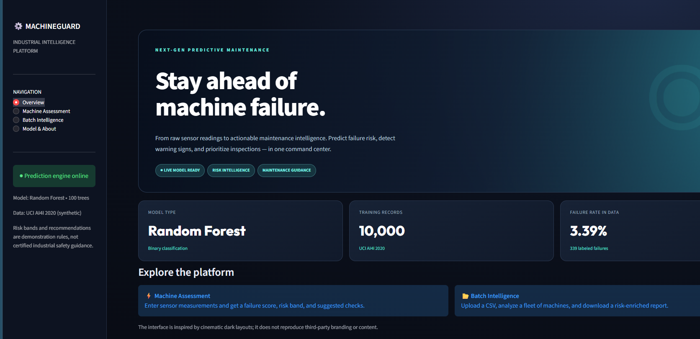
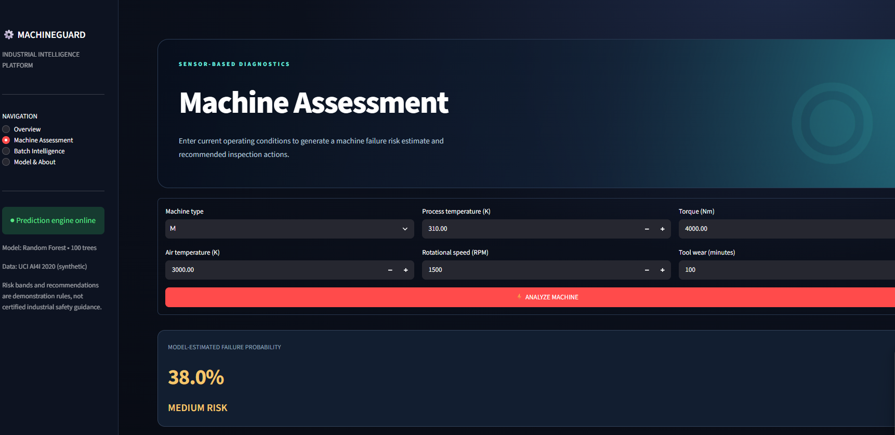
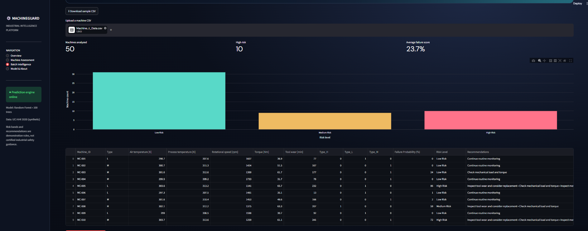

<h1 align="center">⚙️ MachineGuard AI</h1>
<h3 align="center">Predictive Maintenance & Industrial Risk Intelligence</h3>

<p align="center">Machine failure prediction • Risk assessment • Maintenance recommendations • Batch analytics</p>

---

## 📌 Overview

**MachineGuard AI** is an interactive machine-learning application that estimates industrial equipment failure risk using operating measurements. It combines a Random Forest classifier, risk categories, rule-based maintenance recommendations, and a Streamlit dashboard for individual and bulk machine assessments.

> **Note:** This is an educational demonstration trained on synthetic industrial data. Its maintenance rules are not certified industrial safety guidance.

## 🚀 Features

- **Failure prediction:** Model-estimated failure scores from machine sensor inputs.
- **Risk classification:** Low, Medium, and High risk categories.
- **Maintenance guidance:** Suggested checks for tool wear, torque, rotational speed, and process temperature.
- **Manual assessment:** Enter operating conditions and inspect the result.
- **Batch intelligence:** Upload CSV files to analyze multiple machines and download results.
- **Dashboard:** View risk distribution, average failure score, and machine-level recommendations.

## 🖥️ Application Screenshots

### 1. Overview Dashboard

Landing page introducing the predictive maintenance platform, model, and dataset.



### 2. Machine Assessment

Enter operating measurements to estimate failure risk and receive suggested inspections.



### 3. Batch Intelligence

Analyze multiple machines from a CSV file, review risk distribution, and export assessments.



> Upload `D1.png`, `D2.png`, and `D3.png` to the same folder as this README so the images display on GitHub.

## 📊 Dataset

**Source:** [UCI AI4I 2020 Predictive Maintenance Dataset](https://archive.ics.uci.edu/dataset/601/ai4i+2020+predictive+maintenance+dataset)

| Dataset detail | Value |
|---|---:|
| Records | 10,000 |
| Labeled failures | 339 |
| Non-failures | 9,661 |
| Failure rate | 3.39% |
| Data type | Synthetic industrial machine observations |

**Model inputs:** Air temperature (K), process temperature (K), rotational speed (RPM), torque (Nm), tool wear (minutes), and machine type (L/M/H).

Identifiers and failure-mode indicator columns were excluded from model training to avoid leakage.

## 🤖 Machine Learning

- **Algorithm:** Random Forest Classifier (100 trees)
- **Train/test split:** 80/20, stratified
- **Imbalance handling:** `class_weight='balanced'`
- **Experimental prediction threshold:** 0.25 instead of the default 0.50

### Notebook evaluation results

| Metric | Result |
|---|---:|
| Accuracy | 98% |
| Failure precision | 68% |
| Failure recall | 74% |
| Failure F1-score | 70% |

Lowering the classification threshold increased failure recall from **40% to 74%**, with a corresponding decrease in precision from **96% to 68%**.

**Evaluation limitation:** The threshold was explored on the test set, so these metrics are exploratory rather than a fully unbiased final estimate. A production-oriented workflow would select the threshold on validation data, evaluate once on a held-out test set, and check probability calibration. The packaged app may retrain its own model if saved model files are not supplied, so its outputs can differ from notebook results.

## 🛠️ Risk Levels & Recommendations

| Risk level | Model score | Guidance |
|---|---|---|
| Low | Below 25% | Routine monitoring, with checks for any flagged measurements |
| Medium | 25% to below 60% | Review operating conditions and inspect warning indicators |
| High | 60% or above | Prioritize maintenance inspection |

**Example rule-based suggestions:**

- High tool wear → Inspect cutting tools and consider replacement.
- High torque → Check mechanical load and torque conditions.
- Low rotational speed → Inspect motor and drive system.
- High process temperature → Check cooling and temperature controls.

These thresholds are demonstration heuristics, **not** validated safety limits. A low model risk score does not rule out the need to inspect an abnormal measurement.

## 🧰 Tech Stack

**Python · Pandas · NumPy · Scikit-learn · Random Forest · Joblib · Plotly · Streamlit**

## 📁 Project Structure

```text
MachineGuard-AI/
├── app.py
├── train_model.py
├── requirements.txt
├── README.md
├── START_WINDOWS.bat
├── sample_test_data.csv
├── D1.png
├── D2.png
└── D3.png
```

Saved model artifacts (`machineguard_model.pkl` and `feature_names.pkl`) can be generated by training or supplied from the notebook.

## ▶️ Run Locally

**1. Clone the repository**

```bash
git clone https://github.com/namrataamali/MachineGuard-AI.git
cd MachineGuard-AI
```

**2. Install dependencies**

```bash
python -m pip install -r requirements.txt
```

**3. Start Streamlit**

```bash
python -m streamlit run app.py
```

Open `http://localhost:8501` if your browser does not open automatically. On Windows, you can also use `START_WINDOWS.bat`.

**First launch:** If model files are absent, the application may download the UCI dataset and train a model, requiring internet access.

## 🔄 Workflow

1. Load and inspect the UCI dataset.
2. Prepare features and encode machine type.
3. Train a class-weighted Random Forest classifier.
4. Evaluate precision, recall, F1-score, and decision thresholds.
5. Convert scores into risk categories.
6. Generate rule-based maintenance suggestions.
7. Provide manual and CSV-based assessments in Streamlit.

## 🔮 Future Improvements

- Validation-based threshold selection and probability calibration
- Explainable AI with SHAP
- Historical machine monitoring and alert tracking
- Real-time sensor integration
- Failure-mode analysis and maintenance scheduling

## 👩‍💻 Author

**Namrata Amali**  
Aspiring Data Scientist | Data Analyst | Machine Learning Enthusiast  
[GitHub Profile](https://github.com/namrataamali)

---

⭐ If you find this project useful, consider starring the repository.
